

<a href="https://github.com/mklemmingen/react-pixel-cats-and-birds">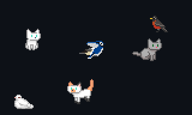</a>
<a href="https://github.com/mklemmingen/migraine-forecasting-shd">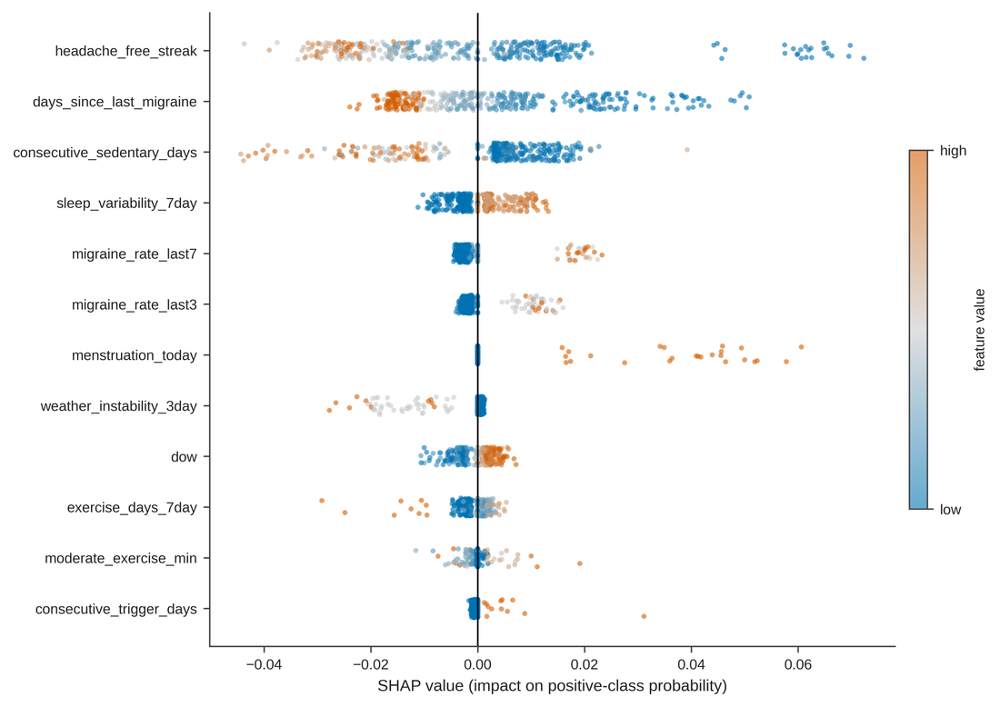</a>
<a href="https://github.com/mklemmingen/migraine-forecasting-shd">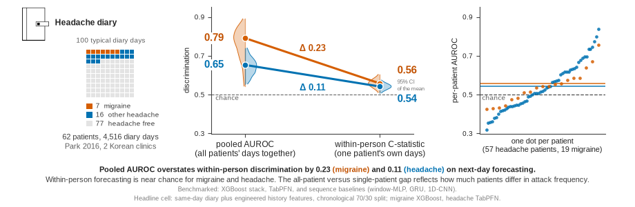</a>
<a href="https://github.com/InnoLab-2026/relay-zero-host">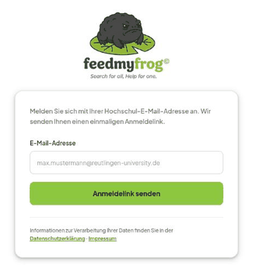</a>

<a href="https://www.youtube.com/watch?v=b6DXtuq9QeY">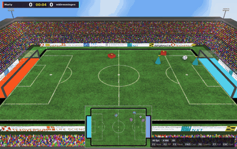</a>
<a href="https://www.linkedin.com/in/martinlauterbach128"><picture><source media="(prefers-color-scheme: light)" srcset="showcase/mercedes-star-dark-text.gif"></picture></a>
<a href="https://github.com/mklemmingen/ALEE"><picture><source media="(prefers-color-scheme: light)" srcset="showcase/alee-architecture-light.png">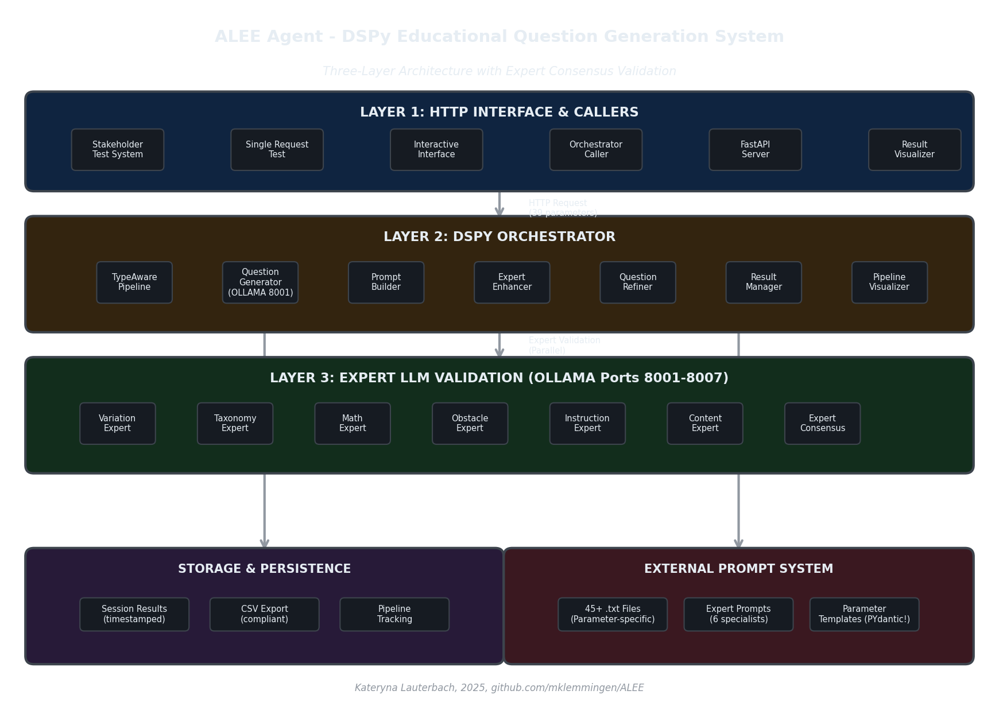</picture></a>

<a href="https://github.com/bettercodepaul/swt2-bsa-backend">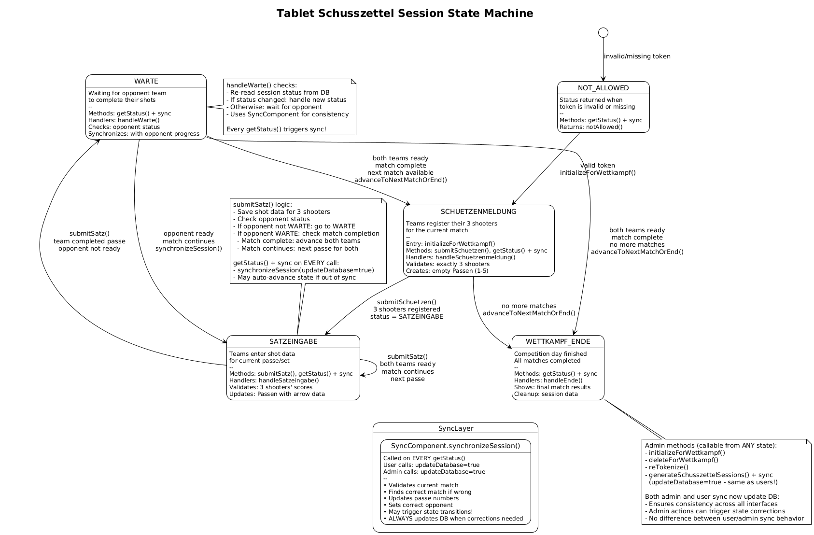</a>
<a href="https://github.com/mklemmingen/MASK">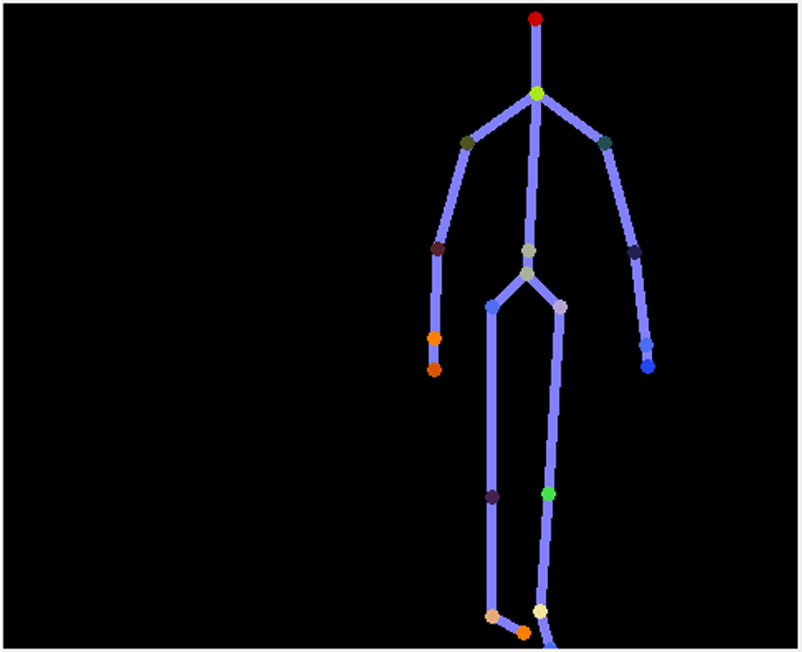</a>

<a href="https://github.com/mklemmingen/TelegramToMap">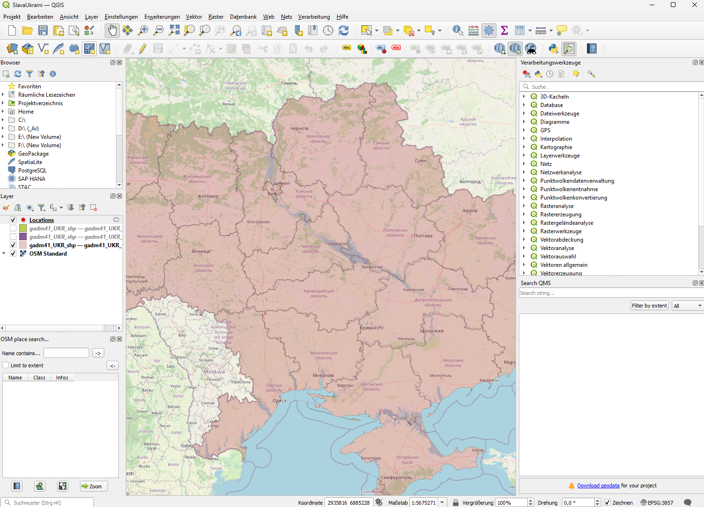</a>

<a href="https://github.com/mklemmingen/R_DataScience_Tutorial">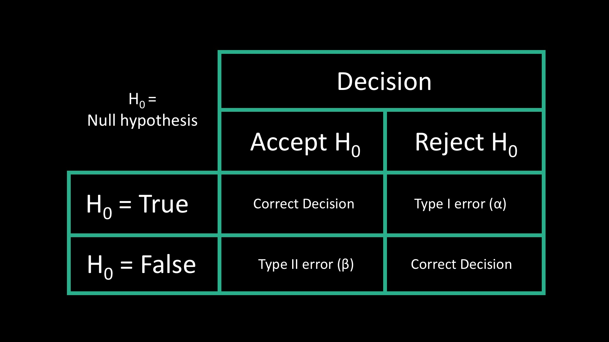</a>
<a href="https://github.com/mklemmingen/OutdoorInfotainment">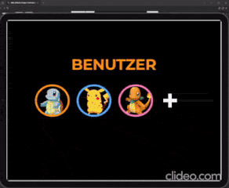</a>
<a href="https://github.com/mklemmingen/KatzenKaffeeWeb">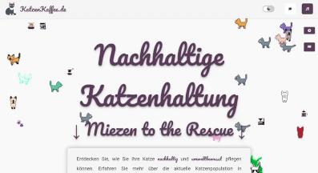</a>
<a href="https://github.com/mklemmingen/HIDmibbi">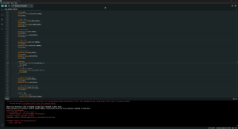</a>

<a href="https://github.com/mklemmingen/CSSArtTutorial">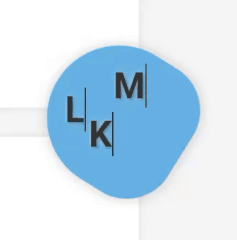</a>
<a href="https://github.com/mklemmingen/Q1Q2Projects2024">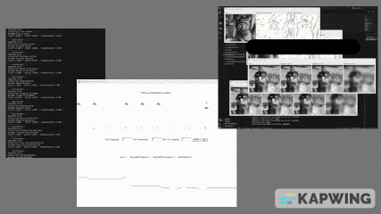</a>
<a href="https://gardeningcat.itch.io/boom-chess">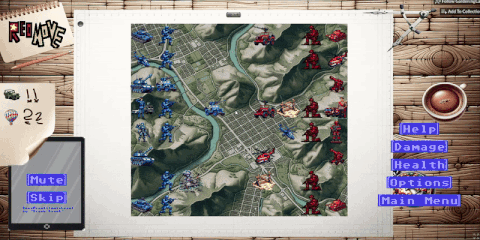</a>
<a href="https://gardeningcat.itch.io/senet-boom">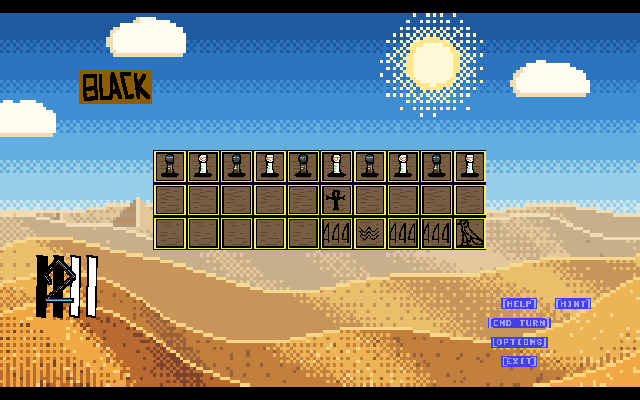</a>

## Projects

<b>Show projects</b>

<table>

  <tr>
  <td width="60%" valign="top">

  ### [spinning-ascii-donut-star | PyPI package: a spinning 3D star in your terminal, rendered as ASCII](https://pypi.org/project/spinning-ascii-donut-star/)

  Click the title to open the package on PyPI. Also: <a href="https://github.com/mklemmingen/spinning-ascii-donut-star">spinning-ascii-donut-star on GitHub</a>

  Q4 2026 | Published

  A **z-buffered 3D star** drawn in ASCII in the style of `donut.c`: tapered spokes, a torus ring and a hub sphere, each with **surface normals and lighting**. The number of points, the ring, the hub and the shading characters are all **configurable** from the command line or from Python. **Pure Python, no dependencies.**

  `pip install spinning-ascii-donut-star`

  Python | ASCII rendering | CLI | PyPI

  </td>
  <td width="40%" align="center" valign="middle">

  <picture><source media="(prefers-color-scheme: light)" srcset="showcase/donut-star-dark-text.gif"></picture>

    

  
   
  <a href="https://pypi.org/project/spinning-ascii-donut-star/">Install from PyPI</a>
  </td>
  </tr>

  <tr>
  <td width="60%" valign="top">

  ### [react-pixel-cats-and-birds | npm package: animated pixel-art cats and birds for React, with synthesised meows and bird calls](https://github.com/mklemmingen/react-pixel-cats-and-birds)

  Click the title to open the repository. Also: <a href="https://www.npmjs.com/package/react-pixel-cats-and-birds">react-pixel-cats-and-birds on npm</a>

  Q4 2026 | MIT (code) | Published

  Drop-in `<Cats>` and `<Birds>` components that turn any section into a **living pixel-art background**: cats walk, run, sit, look around and lie down, birds fly, land and peck. Clicking a sprite plays a **sound synthesised live with the Web Audio API** (source-filter meow model, one call per bird species), so the package ships **no audio files and no dependencies**. Paused and memory-free while off-screen, respects reduced motion, 149 unit tests.

  `npm i react-pixel-cats-and-birds`

  Sprites by [Pop Shop Packs](https://pop-shop-packs.itch.io/), used with permission.

  JavaScript | React | Canvas | Web Audio API | Vitest | Next.js

  </td>
  <td width="40%" align="center" valign="middle">

  <picture></picture>

    

  
   
  <a href="https://www.npmjs.com/package/react-pixel-cats-and-birds">Install from npm</a>
  </td>
  </tr>

  <tr>
  <td width="60%" valign="top">

  ### [LibGDX to ItchIO for HSRT-Students | Template for University Students learning OOP Backend-Frontend Separation via Interfaces - and want to compile their game into a itch.io accessible bundle](https://github.com/KatIncluded/Template-LibGdx-toItchIO-HSRT)

  Click the title to open the repository

  Q3Q4 2026 | Template Repository | INF Faculty HSRT - TA Job

  Java | Gradle

  </td>
  <td width="40%" align="center" valign="middle">

  
  </td>
  </tr>

  <tr>
  <td width="60%" valign="top">

  ### [VISIR Research Group | Migraine Prediction Models: XGBooststacking -> foundational tabular models (TabPFN) -> explainability -> temporal & sequence models -> personalisation & clinical value](https://github.com/mklemmingen/migraine-forecasting-shd)

  Click the title to open the repository

  Q2Q3 2026 | Journal Paper | TEC Faculty HSRT

  Next-day headache and migraine forecasting on the Park 2016 Smartphone Headache Diary cohort (n=62): architecture benchmark to measure model qualitites across different configurations and determine validity of common Measurements of ROC

  Python | XGBoost | TabPFN | SHAP / ShapIQ / ALE | PyTorch |
  scikit-learn

  </td>
  <td width="40%" align="center" valign="middle">

  

    

  
  

  </td>
  </tr>
  <tr>
  <td colspan="2" align="center">

  

  </td>
  </tr>

<tr>
<td width="60%" valign="top">

### [Community-based Everything-Exchange Bulletin Board: Plug & Play, Data-Frugal, for any kind of email-domain-sharing entity](https://github.com/InnoLab-2026/relay-zero-host)

Click the title to open the repository

Q2Q3 2026 | INF Faculty HSRT

**Self-hosted, privacy-first connection platform** with magic-link authentication, SSR React, and a no-log architecture. Designed for institutional deployment with minimal data footprint and full data sovereignty.

**Live:** [feedmyfrog.click](https://feedmyfrog.click)

React (SSR), Neon, Magic Link, Postgres
</td>
<td width="40%" align="center" valign="middle">

  

</td>
</tr>

<tr>
<td width="60%" valign="top">

### [Continual μ-Training on Edge Devices: A Survey of On-Device Personalisation](https://github.com/mklemmingen/ContinualEdgeDevicePersonalisation)

Click the title to open the repository. Also: <a href="https://doi.org/10.5281/zenodo.20599083">DOI</a>

Q2 2026 | Conference Paper | INF Faculty HSRT

Wearable and IoT data drifts per user, and **uploading gradients to the cloud is vulnerable to gradient-leakage attacks**. This paper surveys **continual on-device μ-training**, which updates only a small part of a pre-trained network directly on the device. It finds that **per-update energy on wearables is unreported** in every surveyed source, and a **Raspberry Pi 5 pilot** measures a **4.0-fold marginal-energy advantage** over full-network training.

PyTorch | Raspberry Pi 5 | DA9091 PMIC (vcgencmd) | LaTeX (IEEEtran)
</td>
<td width="40%" align="center" valign="middle">

  

</td>
</tr>
<tr>
<td colspan="2" align="center">

Live PMIC trace from the 440 s pilot run, coloured by phase, in order: idle, inference and timing, 5-config trainable-fraction sweep, SGD vs Adam, WLV drift detector, BWT proxy, teardown.
</td>
</tr>

<tr>
<td width="60%" valign="top">

### VISIR Research Group | ModernGL 3D Visualisation of RoboSoccer

Q1 2026 | TEC Faculty HSRT

**3D visualisation suite** for RoboSoccer built using exclusively mathematical objects. Renders full match scenes with **procedurally defined geometry** and no imported assets. Includes a recorded, animated and **edited trailer**.

[Trailer](https://www.youtube.com/watch?v=b6DXtuq9QeY)

ModernGL, Python

</td>
<td width="40%" align="center" valign="middle">

 
Watch the trailer

  

</td>
</tr>

<tr>
<td colspan="2">
Textual | Q1 2026 | German | 14 pages 
<a href="https://github.com/mklemmingen/Papers/blob/main/2026-Q1-AuthenticValuesBasedMarketing.pdf"><b>Authentic values-based marketing: analysis and framework for assessing value communication</b></a> 
Separates authentic values-based marketing from greenwashing, building on the Seven Sins of Greenwashing and Marketing 3.0, and proposes a framework along integration depth and verifiability.
</td>
</tr>

<tr>
<td colspan="2">
Textual | Q1 2026 | German | 32 pages 
<a href="https://github.com/mklemmingen/Papers/blob/main/2026-Q1-Praktikumsbericht_Lauterbach_WiSe2526_Sept_Febr_Mercedes-Benz.pdf"><b>Internship report: Pre-Integration Connected Features @ Mercedes-Benz</b></a> 
Report on the September 2025 to February 2026 internship in connected-car pre-integration at Mercedes-Benz.
</td>
</tr>

<tr>
<td width="60%" valign="top">

### Mercedes-Benz | Test Session Data Collection & Ticket Generation

Q4 2025 - Q1 2026

Production desktop tool for **vehicle test engineers**. When a marker is pressed, it captures video clips, diagnostic reports, logger traces and vehicle state in parallel. Aggregates everything into a **ready-to-file ticket** with AI-generated defect descriptions. Reduces per-incident data collection from **30+ minutes across 5+ systems to under 10**.

**Internal tool. Source not publicly available.**

Python 3.12, wxPython, Playwright, OpenCV, PyTurboJPEG, edge-tts, Google Gemini API, pandas, matplotlib, pytest

</td>
<td width="40%" align="center" valign="middle">

  

&nbsp;&nbsp;

&nbsp;&nbsp;

</td>
</tr>

<tr>
<td width="60%" valign="top">

### [SemesterModuleMatching | 3-Layer PyPI Package Suite](https://github.com/mklemmingen/webuntis-public)

Click the title to open webuntis-public. Also: <a href="https://pypi.org/project/webuntis-public/">webuntis-public on PyPI</a>, <a href="https://github.com/mklemmingen/hsrt-timetable">hsrt-timetable</a>, <a href="https://pypi.org/project/hsrt-timetable/">hsrt-timetable on PyPI</a>, <a href="https://github.com/mklemmingen/wahlfach-matching">wahlfach-matching</a>

Q1 2026 | Apache-2.0 | Deprecated

> **Deprecated:** Hochschule Reutlingen has moved its timetables from WebUntis to HISinOne, so the suite no longer fetches HSRT data. `webuntis-public` still works for other schools that use WebUntis.

Three packages forming a **layered dependency chain** for university timetable data. Queries timetables and **optimizes elective selections**. The CLI scores electives against schedule conflicts and exports **ranked results as ICS calendar files**.

Python 3.10+, requests, icalendar, WebUntis REST API, GitHub Actions, PyPI Trusted Publishers

</td>
<td width="40%" align="center" valign="middle">

  

</td>
</tr>

<tr>
<td colspan="2">
Textual | Q4 2025 | German | 32 slides 
<a href="https://github.com/mklemmingen/Papers/blob/main/2025-10-04_IntelliJ%26GitWorkshopINF2.pdf"><b>IntelliJ & Git workshop for INF2 students</b></a> 
Teaching-assistant workshop slides: setting up IntelliJ and working with the university GitLab, from empty project to finished result.
</td>
</tr>

<tr>
<td width="60%" valign="top">

### [ALEE | Educational Question Generation System](https://github.com/mklemmingen/ALEE)

Click the title to open the repository

Q3 2025

Research system generating **educational questions** using multi-layered small language models with DSPy Chain-of-Thought. An orchestrator dispatches to data-backed generators. **Parallel expert panels** validate the output in a single pass. Built for the Leibniz-Institut and **University of Tubingen** as part of the [ALEE project](https://www.iwm-tuebingen.de/en/research/projects/ALEE).

**Roles:** Educational parameters: [K-Laut](https://github.com/k-laut). System architecture and DSPy: mklemmingen

DSPy, Python, OLLAMA, Pydantic, FastAPI, ROCm

</td>
<td width="40%" align="center" valign="middle">

  

&nbsp;&nbsp;

</td>
</tr>
<tr>
<td colspan="2" align="center">

<picture><source media="(prefers-color-scheme: light)" srcset="showcase/alee-architecture-light.png"></picture>

</td>
</tr>

<tr>
<td width="60%" valign="top">

### [LogChirpy | Ornithological Archival App](https://github.com/mklemmingen/LogChirpy)

Click the title to open the repository

Q2-Q3 2025 | AGPL-3.0 | Finished

Mobile app that identifies birds from **live camera feed, pictures and sound** entirely on-device. Archives sightings with visual logs and optionally syncs to **Firestore with DSGVO-compliant authentication**. Uses wrapped open-source models converted for **TensorFlow.js mobile inference**.

TensorFlow.js, TypeScript, React Native, Expo, SQL, Firebase, Computer Vision

</td>
<td width="40%" align="center" valign="middle">

 

</td>
</tr>

<tr>
<td colspan="2">
Textual | Q3 2025 | English | 64 pages | 3 authors 
<a href="https://github.com/mklemmingen/Papers/blob/main/2025_Q3_LogChirpy_Documentation.pdf"><b>LogChirpy: documentation of the ornithological archival app</b></a> 
Project documentation for LogChirpy: on-device bird recognition from images and sound, offline-first storage, six languages and a 30,000+ species database.
</td>
</tr>

<tr>
<td width="60%" valign="top">

### [Bogenliga | Digitaler Schusszettel](https://github.com/bettercodepaul/swt2-bsa-backend)

Click the title to open the backend repo. Also: <a href="https://github.com/bettercodepaul/swt2-bsa-frontend">frontend repo</a>

Q2-Q3 2025 | All rights with BetterCallPaul & Bogenliga Deutschland | Finished

Module for [app.bogenliga.de](https://app.bogenliga.de) providing a **fully digital pass entry system** for official archery tournaments. Uses state machines to enforce **tournament scoring rules** with admin oversight. Integrates into the existing full-stack application as a **new module**.

Spring Boot, Java, REST APIs, TypeScript

</td>
<td width="40%" align="center" valign="middle">

 

&nbsp;&nbsp;

</td>
</tr>

<tr>
<td width="60%" valign="top">

### [MASK | Machine-Learning Assisted Skeleton Kinect Tracking | Echoes of the Mind, Filmakademie Ludwigsburg x Hochschule Reutlingen Fakultät Informatik](https://github.com/mklemmingen/MASK)

Click the title to open the repository

Q2-Q3 2025 | AGPL-2.0 | Finished

**Real-time skeleton tracking** in TouchDesigner using Kinect V2 and MediaPipe for dance and performance setups. Calculates distances and angles to **move projected visuals** relative to the performer's body. Built in collaboration with **Filmakademie Ludwigsburg**.

[Documentation](https://github.com/mklemmingen/MASK/blob/main/README.md) | [Presentation video](https://www.youtube.com/watch?v=2jvziSgExTw)

Python, MediaPipe, TouchDesigner, Kinect V2

</td>
<td width="40%" align="center" valign="middle">

  
<picture><source media="(prefers-color-scheme: light)" srcset="filmakademie-logo-dark.png"></picture>
  

</td>
</tr>

<tr>
<td colspan="2">
Textual | Q2 2025 | German | 66 pages 
<a href="https://github.com/mklemmingen/Papers/blob/main/2025_Q2_MASK_EchoesOfTheMind_MKI-Project.pdf"><b>M.A.S.K.: Machine-Learning Assisted Skeleton Kinect Tracking</b></a> 
Project report on the low-cost motion-capture system built for the dance film Echoes of the Mind, including the infrared adaptation that keeps tracking reliable under projector light.
</td>
</tr>

<tr>
<td colspan="2">
Textual | Q2 2025 | German | 6 pages 
<a href="https://github.com/mklemmingen/Papers/blob/main/2025_Q2_RechtlicheUnterscheidungZwischenEinerMahnungUndEinerAbmahnung.pdf"><b>The legal difference between a Mahnung and an Abmahnung</b></a> 
Short legal paper on how a payment reminder (Mahnung) and a formal warning (Abmahnung) differ in German law, in purpose and in legal consequences.
</td>
</tr>

<tr>
<td colspan="2">
Textual | Q2 2025 | English | 29 slides | 3 presenters 
<a href="https://github.com/mklemmingen/Papers/blob/main/2025_Q2_Battery%20Optimization%20for%20Mobile%20Devices.pdf"><b>Battery optimization for mobile devices</b></a> 
Overview of software techniques that extend battery life on mobile devices.
</td>
</tr>

<tr>
<td colspan="2">
Textual | Q4 2024 - Q2 2025 | German | 21 pages 
<a href="https://github.com/mklemmingen/Papers/blob/main/2024_Q4_2025_Q2_GitCheatSkriptForStudents.pdf"><b>Git cheat script for students</b></a> 
Step-by-step guide for first-semester students: installing Git and Java, signing in to the university GitLab, managing a small project, and using Teams.
</td>
</tr>

<tr>
<td width="60%" valign="top">

### [EntropyVisualizer | Arduino Sensor-Based Randomness](https://github.com/mklemmingen/EntropyVisualizer)

Click the title to open the repository

Q2 2025 | AGPL-3.0 | Finished

Microcontroller generating **randomness from analog sensor noise** including gas, temperature and microphone data. Visualizes entropy with an LED strip and **outputs random unsigned integers** over serial. Readable by **any program** on the other end.

C++, Arduino

</td>
<td width="40%" align="center" valign="middle">

</td>
</tr>

<tr>
<td width="60%" valign="top">

### [TelegramToMap | Automatic Threat-Location Mapping](https://github.com/mklemmingen/TelegramToMap)

Click the title to open the repository

Q2 2025 | AGPL-3.0 | Ongoing

Scans Telegram group messages for **Ukrainian air alarm data**. Extracts locations of UAVs, missiles and planes. Plots **time-fading markers on a QGIS map**. Runs **fully local** after receiving the Telegram data.

Python, QGIS

</td>
<td width="40%" align="center" valign="middle">

</td>
</tr>

<tr>
<td width="60%" valign="top">

### [Exif_DataByDate_Sorting](https://github.com/mklemmingen/Exif_DataByDate_Sorting)

Click the title to open the repository

Q1 2025 | AGPL-3.0 | Finished

Automates file organization into structured **year/month/type directories** using EXIF metadata or file system dates. Verifies integrity with **hash-based backup checks** before moving files. Built for **data recovery and long-term archival** workflows.

JavaScript

</td>
<td width="40%" align="center" valign="middle">

</td>
</tr>

<tr>
<td width="60%" valign="top">

### [R Data Manipulation Tutorial](https://github.com/mklemmingen/R_DataScience_Tutorial)

Click the title to open the repository

Q1 2025 | MIT | Finished

Interactive **browser-based statistics tutorial** teaching data science approaches through a self-collected dataset. Covers hypothesis testing, visualization and manipulation in **R with rendered HTML output**. Includes a companion **YouTube playlist** walking through each section.

R, HTML, CSS, Markdown

</td>
<td width="40%" align="center" valign="middle">

&nbsp;

</td>
</tr>

<tr>
<td width="60%" valign="top">

### [Mixtape | 270-Degree Interactive Digital Art](https://github.com/mklemmingen/MIXTAPE)

Click the title to open the repository

Q1 2025 | AGPL-3.0 | Finished

Art installation projecting across **270 degrees**. Links birthday audio recordings to reactive visuals. Combines **Arduino sensor input** with TouchDesigner and DaVinci Resolve. Exhibited as a **walk-through projection room**.

TouchDesigner, DaVinci Resolve, Python, Arduino C++

</td>
<td width="40%" align="center" valign="middle">

</td>
</tr>

<tr>
<td colspan="2">
Textual | Q1 2025 | German | 49 pages | 6 authors 
<a href="https://github.com/mklemmingen/Papers/blob/main/2025_Q1_MIXTAPE_DigitalArt.pdf"><b>Mixtape: documentation of the art installation</b></a> 
Documentation of the 270-degree interactive installation that leads visitors through the birthday memories of a life, steered by narration and a radio.
</td>
</tr>

<tr>
<td width="60%" valign="top">

### [Modern Offroad Vehicle Infotainment System](https://github.com/mklemmingen/OutdoorInfotainment)

Click the title to open the repository

Q1 2025 | MIT | Finished

UI/UX design for a **family outdoor vehicle infotainment system** covering navigation, vehicle controls and media. Prototyped in **Figma with interactive flows** and exported to HTML. Uses **large touch targets** and high-contrast layouts.

Figma, HTML

</td>
<td width="40%" align="center" valign="middle">

&nbsp;

</td>
</tr>

<tr>
<td width="60%" valign="top">

### [KatzenKaffee](https://github.com/mklemmingen/KatzenKaffeeWeb)

Click the title to open the repository

Q4 2024 | AGPL-3.0 | Finished

Full-stack website teaching **sustainable cat ownership** through interactive content and quizzes. Serves pages with **server-side rendering** and stores progress in a local SQLite database. Live and publicly accessible at **[katzenkaffee.vercel.app](https://katzenkaffee.vercel.app/)**.

Next.js, React, SQLite

</td>
<td width="40%" align="center" valign="middle">

&nbsp;

</td>
</tr>

<tr>
<td width="60%" valign="top">

### [HIDmibbi | Educational USB Security Visualization](https://github.com/mklemmingen/HIDmibbi)

Click the title to open the repository

Q3 2024 | AGPL-3.0

Educational tool demonstrating **HID attack vectors** using cheap USB microcontrollers. Visualizes rubber ducky-style exploits through a UI to illustrate **USB security vulnerabilities** on Windows 11. Built for **security awareness training** and classroom demonstrations.

C++, Arduino

</td>
<td width="40%" align="center" valign="middle">

</td>
</tr>

<tr>
<td width="60%" valign="top">

### [BoardGame Jam Frameworks](https://github.com/mklemmingen/GameJamFramework)

Click the title to open the blank framework. Also: <a href="https://github.com/mklemmingen/GameJamChess">Chess</a>, <a href="https://github.com/mklemmingen/GameJamCheckers">Checkers</a>

Q3 2024 | AGPL-3.0 | Finished

Three **ready-to-fork board game frameworks** providing a blank template, a chess implementation and a checkers implementation. Each runs as a **standalone desktop application** with rendering, input and game loop handled. Fork one, have a **running board game** in minutes.

Java, LibGDX

</td>
<td width="40%" align="center" valign="middle">

&nbsp;

</td>
</tr>

<tr>
<td width="60%" valign="top">

### [CSS Art Tutorial](https://github.com/mklemmingen/CSSArtTutorial)

Click the title to open the repository

Q3 2024 | AGPL-3.0 | Finished

Step-by-step tutorial on creating **animated logos** using only CSS. Covers keyframes, transforms and transitions with **working examples** at each step. Single HTML file with **live-editable code**, no build step.

HTML, CSS

</td>
<td width="40%" align="center" valign="middle">

</td>
</tr>

<tr>
<td width="60%" valign="top">

### [Q1-Q2 2024 Study Projects](https://github.com/mklemmingen/Q1Q2Projects2024)

Click the title to open the repository

Q1-Q2 2024 | MIT | Finished

Four university projects. **Levenshtein distance restorer** in C++. Producer-consumer displayer in Java AWT. Function graph plotter in Python. **PGM filter operations** with custom canvas display.

C++, C#, Java, Python

</td>
<td width="40%" align="center" valign="middle">

&nbsp;

</td>
</tr>

<tr>
<td colspan="2">
Textual | Q2 2024 | German | 19 pages | 3 authors 
<a href="https://github.com/mklemmingen/Papers/blob/main/2024_Q2_Ransomware_in_der_Medizin.pdf"><b>Best practices for awareness and protection against ransomware in medicine</b></a> 
Practical strategies for hospitals and practices against ransomware and phishing, combining technical measures with staff training, in light of new German digital-health laws.
</td>
</tr>

<tr>
<td width="60%" valign="top">

### [Boom Chess](https://github.com/mklemmingen/boom-chess)

Click the title to open the desktop version. Also: <a href="https://github.com/mklemmingen/BoomChess-Android">Android version</a>

Q3 2023 - Q1 2024 | AGPL-3.0

Military-pixel chess variant where pieces have **health and complex combat relations** instead of instant captures. Includes three **bot difficulty modes**, challenge scenarios and multiple team colors. Available as a **desktop and Android app** with music by Wambutz.

<a href="https://gardeningcat.itch.io/boom-chess" target="_blank" rel="noopener">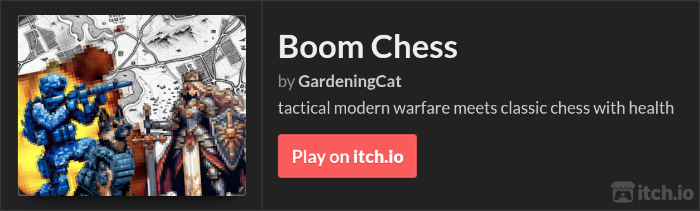</a>

Java, libGDX

</td>
<td width="40%" align="center" valign="middle">

&nbsp;

</td>
</tr>

<tr>
<td width="60%" valign="top">

### [Senet: A Simple Workers Game](https://github.com/mklemmingen/senet-boom)

Click the title to open the repository

Q4 2023 | AGPL-3.0 | Finished

The oldest known board game **re-created as a speedrun challenge** with libGDX. Players race pieces across thirty squares following **ancient Egyptian rules** with stick-throw randomness. Built as a **single-session desktop game**, now also **playable in the browser**.

Java, libGDX, TeaVM

</td>
<td width="40%" align="center" valign="middle">

</td>
</tr>

<tr>
<td colspan="2">
Textual | Q4 2023 | German | 8 pages | 3 authors 
<a href="https://github.com/mklemmingen/Papers/blob/main/2023_Q4_Radiologie_und_EDV.pdf"><b>Radiology, RIS and PACS</b></a> 
Medical-informatics paper on radiology information systems and picture archiving, with an annotated source list.
</td>
</tr>

<tr>
<td width="60%" valign="top">

### [Space Mouse: The Special Operodent](https://github.com/mklemmingen/space-mouse)

Click the title to open the repository

Q2 2023 | CC0 | Finished

A **randomly generated 3D maze** game where a space mouse searches for cheese. Each run produces a **unique procedural layout** with varying difficulty. Playable as a lightweight **single-file Python game**.

Python

</td>
<td width="40%" align="center" valign="middle">

</td>
</tr>

<tr>
<td width="60%" valign="top">

### [Hangman 2 | The Dictionaries Strike Back](https://github.com/mklemmingen/hangman-2)

Click the title to open the repository

Q2 2023 | Unlicense | Finished

Word-guessing game that uses datasets and hash maps to calculate the **most likely word** from partial letter reveals. The AI opponent selects words that are **statistically hardest to guess** given current letters. Difficulty scales with the **dataset**.

Python

</td>
<td width="40%" align="center" valign="middle">

&nbsp;

</td>
</tr>

<tr>
<td width="60%" valign="top">

### [StopTheToken](https://github.com/mklemmingen/StopTheToken)

Click the title to open the repository

Ongoing | Unlicense

A community-fed **Pi-hole blocklist** of websites publishing AI-generated content as original articles. Updated through **community contributions** via pull requests. Import the list into Pi-hole or any DNS-based blocker to **filter AI article farms** from your network.

Plain text

</td>
<td width="40%" align="center" valign="middle">

</td>
</tr>

<tr>
<td width="60%" valign="top">

### [Retro-Game Guides](https://github.com/mklemmingen/turn.and.burn.no-fly.zone)

Click the title to open the repository

Ongoing

</td>
<td width="40%" align="center" valign="middle">
</td>
</tr>

</table>

